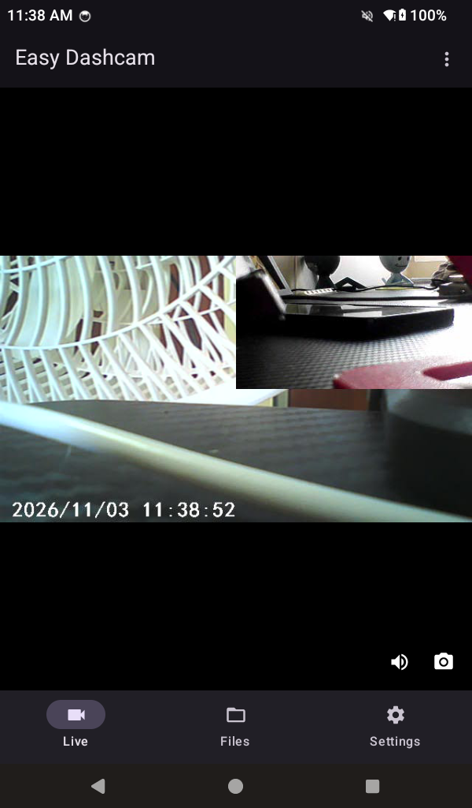
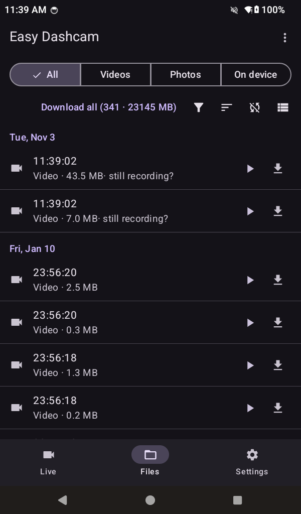
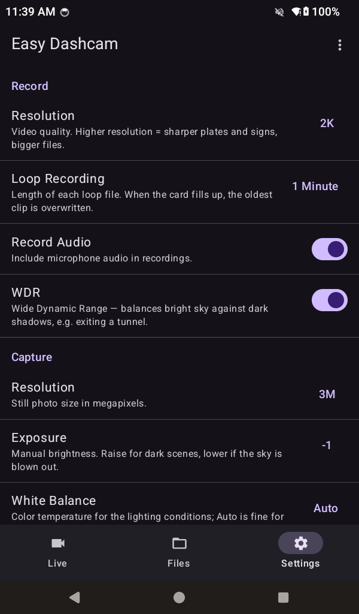

# Easy Dashcam

Easy Dashcam is a local-only Android companion app for compatible Wi-Fi dashcams normally used with Viidure. It connects your phone directly to the camera so you can watch the live feed, browse recordings and photos, save media to your phone, and change camera settings.

This app requires a separate, compatible dashcam; it does not turn your phone into one. It runs on Android 8.0 or later (API 26).

## Objective

Make everyday dashcam tasks accessible without an account, advertising, subscriptions, or a cloud connection. Your camera and recordings should be usable directly, even when the camera's Wi-Fi network has no internet access.

Easy Dashcam is an alternative to the Viidure workflow, focused on local access to your own hardware and media rather than online services.

## Screenshots

| Live view | Files | Settings |
|-----------|-------|----------|
|  |  |  |

## Why replace Viidure?

The original motivation for Easy Dashcam was Viidure's ad-heavy experience, paid membership restrictions on basic features, and observed connections to external, third-party servers while browsing the camera. Accessing recordings on your own camera should not require those extras.

Easy Dashcam talks directly to the camera on its own Wi-Fi hotspot — no account, no ads, no telemetry, and no cloud connection.

The external-server activity is a concern about unnecessary network communication, not proof that recordings were uploaded. Two sources back the concern:

- **Our packet captures** (taken while the phone was connected to the camera's internet-less hotspot) show DNS lookups for `app-api.lufengzhe.com` — Viidure's own cloud API — plus `mshield.baidu.com`, `loc.map.baidu.com`, and `api.map.baidu.com`, and a live TLS session to a Baidu IP. The captures are not app-attributed and the TLS payloads were not decrypted.
- **Its location permission** goes beyond what Android requires: any app joining a device Wi-Fi network needs location access, but Viidure also queries `loc.map.baidu.com` — Baidu's geolocation service — so the granted permission feeds a third-party location SDK, not just the Wi-Fi connection.
- **Independent research** ([Brown Fine Security](https://brownfinesecurity.com/blog/police-bodycam-data-to-china), covered by [GBHackers](https://gbhackers.com/police-body-camera-apps/)) decrypted Viidure's traffic and found it posts device identifiers (IMEI, model, app version) to `app-api.lufengzhe.com` on a Huawei-hosted IP block, and that the app accepts forged TLS certificates.

Easy Dashcam declares no location permission — its Wi-Fi access uses `NEARBY_WIFI_DEVICES` flagged `neverForLocation`, so it can never read your GPS.

The packet-capture analysis used during development lives at `../docs/recon/` in the developer's workspace, outside this repository, and is not shipped here. Those notes describe camera communication, not a detailed audit of Viidure's external traffic.

## Features

### Live view

- Watch the camera's live video feed over its Wi-Fi connection.
- Listen to live audio, with a mute control.
- Save a snapshot of the current frame to your phone.
- Keep the screen awake while watching the live feed.

### Recordings and photos

- Browse the camera's SD card through All, Videos, Photos, and On device subtabs.
- Filter by date (today, yesterday, or a chosen day) and sort within each day by time or file size.
- Switch between list, grid, and timeline views.
- Use the last cached camera file list and open saved copies while disconnected. On device shows saved files matched against that list, not every file on the phone.
- See available phone storage in the file-list footer.

### Downloads and playback

- Download media in the background through a foreground `DownloadService`, with progress notifications and in-row cancellation.
- Download individual files or queue all missing files in the current filtered view.
- Toggle automatic downloads for new, unlocked media recorded after the option is enabled. Files are queued when the camera file list refreshes, not by a continuous background camera scan.
- Play downloaded recordings inside the app with seeking, including the camera's MJPEG-in-AVI format that stock players may not support.
- View saved photos inside the app.
- On Android 10 and later, save photos and snapshots in MediaStore Images under `Pictures/EasyDashcam`, and videos under `Movies/EasyDashcam`. Android 8–9 use app-specific external storage instead.

### Camera settings

- Read the camera's own settings menu and available options.
- Change supported toggle and selection settings directly from the phone.
- View read-only information exposed by the camera, such as its firmware version.

Debug builds also expose a diagnostics screen with a protocol frame log through the overflow menu; this menu entry is not available in release builds.

## How it works

1. Turn on your dashcam and enable its Wi-Fi hotspot.
2. Connect your Android phone to the camera's Wi-Fi network. Internet access is not required. The connection screen provides a shortcut to Android's Wi-Fi panel (Wi-Fi settings on Android 8–9).
3. Open Easy Dashcam and connect to the camera.
4. Use the Live, Files, and Settings screens to access the camera.

Camera communication stays on the local network. The app does not require an account or a cloud service.

## Compatibility and limitations

- The implementation targets the reverse-engineered GPSOCKET camera protocol described below. Compatibility with every camera supported by Viidure is not guaranteed.
- Live preview and downloads use different camera modes and cannot operate independently at the same time. A download can interrupt the live feed.
- Locked event clips are hidden because the target camera refuses to transfer them.
- A recording that the camera is still writing may not be available for download yet; try an older clip or retry later.
- Destructive camera actions, such as formatting the SD card or resetting the camera, are not exposed in Settings.

## Camera protocol

The target camera hosts a Wi-Fi access point at `192.168.100.1`:

- TCP `8081` — GPSOCKET binary protocol for commands, settings, file lists, and downloads.
- TCP `8080` — RTSP session at `rtsp://192.168.100.1:8080/?action=stream`, without authentication. Media travels over UDP: MJPEG video (RTP payload type 26) and an L16 audio track.
- Live media requires entering GPSOCKET preview mode before playback. Camera modes are shared between preview, settings, and file transfers.

See [AGENTS.md](AGENTS.md) for protocol details, [the captured settings menu](docs/camera_menu.xml), and [the crash course](docs/crash-course.md) for an implementation tour. The original packet-capture analysis in `../docs/recon/` is outside this repository and is not included. [Code review notes](docs/code-review-2026-10.md) and [the roadmap](docs/roadmap.md) are included under `docs/`.

## Build

Use Android Studio or a command-line Android SDK installation with SDK Platform 35. Set the SDK location in an untracked `local.properties` (`sdk.dir=...`) or through `ANDROID_HOME`. Use JDK 21 (Android Studio's JBR 21 is suitable) and Gradle 8.9; set `JAVA_HOME` to that JDK and make `gradle` available on `PATH`.

The repository includes `gradle/wrapper/gradle-wrapper.properties`, but not the wrapper scripts or JAR. Use an installed Gradle 8.9 rather than `./gradlew`. Run these commands from the repository root:

```sh
gradle :app:assembleDebug        # signed debug build
gradle :app:assembleRelease      # minified; signed only with release signing configured
gradle :app:lintDebug            # Android lint
gradle :app:testDebugUnitTest    # JVM unit tests
```

The application ID is `com.juanm.easydashcam`; the current version is `0.2.0` (version code 2). Debug APK output: `app/build/outputs/apk/debug/app-debug.apk`.

Release signing is optional: put a keystore and a `keystore.properties` file at the repository root. The properties file and `*.jks` / `*.keystore` files are gitignored. Merely placing a keystore there is not enough; configure all four properties:

```properties
storeFile=easydashcam.jks
storePassword=...
keyAlias=easydashcam
keyPassword=...
```

Install a debug build on an authorized USB-debugging device with Android SDK Platform Tools:

```sh
adb install -r app/build/outputs/apk/debug/app-debug.apk
```

`tools/deploy_app.py` is a developer-specific Windows helper, not a portable setup script. It hardcodes the project directory, Android SDK `adb.exe`, and Android Studio JBR paths, and searches `%USERPROFILE%\.gradle\wrapper\dists` for an already-cached Gradle 8.9 distribution. Adjust those paths before using `python tools/deploy_app.py`; `python tools/deploy_app.py --logcat` only tails logs and does not build or deploy.

## Stack

Kotlin 2.0.21, Android Gradle Plugin 8.7.3, Gradle 8.9, compile/target SDK 35, minimum SDK 26, Jetpack Compose (BOM 2024.12.01, Material 3), MVVM, OkHttp 4.12.0, and coroutines 1.9.0. Java/Kotlin bytecode targets Java 17; the build uses JDK 21.

RTSP/MJPEG live viewing (`RtspMjpegClient`) and AVI/MJPEG playback (`AviMjpegPlayer`) use custom implementations. Media3 ExoPlayer and UI 1.5.1 are dependencies, but do not power those playback paths. See [docs/crash-course.md](docs/crash-course.md) for the implementation tour.

## License

GPL-3.0 — see [LICENSE](LICENSE).
